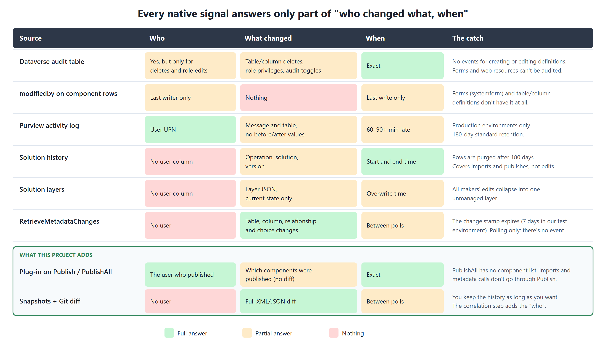
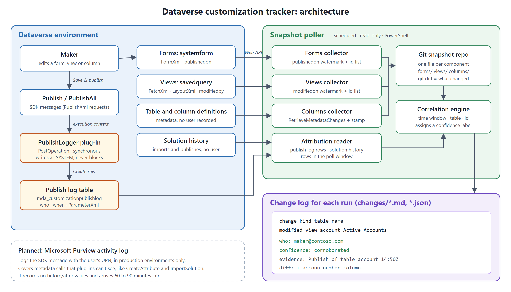
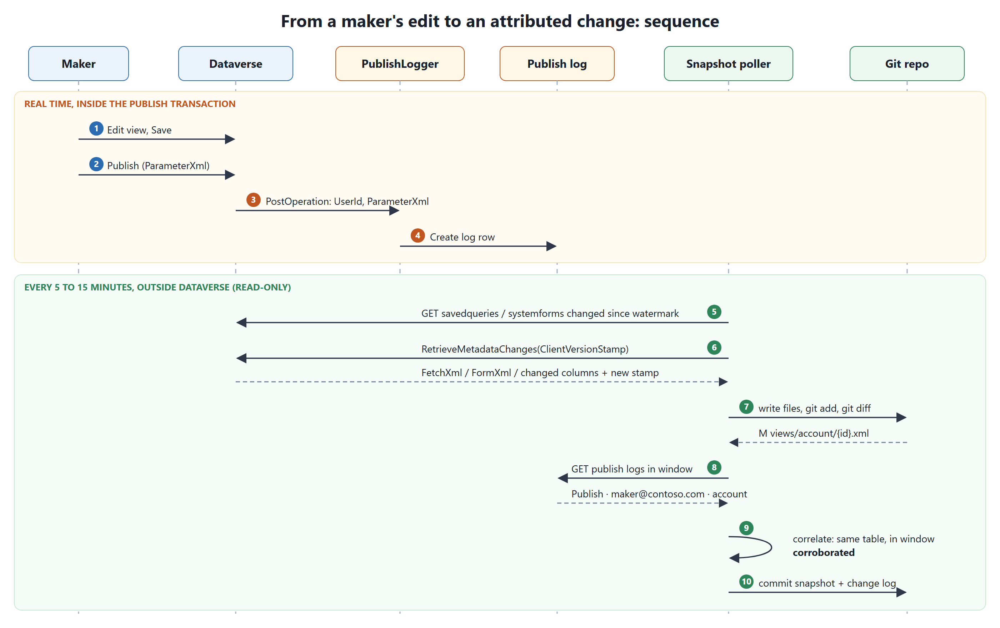

# Who changed my form? Building a customization audit trail for Dataverse

*Dataverse can't tell you who edited a form, added a column or changed a view. Here's how I combined a small plug-in, a snapshot poller and Git to get that answer, and what I learned testing it against a real environment.*

---

Every Dynamics 365 / Power Platform team eventually has this conversation:

> "The Account form changed overnight. Who did it?"
> "No idea. Check the audit log?"
> "There's nothing in there."

There's nothing in there because Dataverse auditing tracks **data**, not **customizations**. Microsoft says it directly in the auditing documentation: auditing *"isn't supported on table or column definition changes."*

So I set out to answer two questions:

1. Is it actually possible to track **who changed what** in Dataverse customizations (forms, views, columns)?
2. If it is, what's the simplest design that works?

The short answer: **yes, but no single native source gives you all of it.** You have to stitch the answer together. The rest of this article shows how I did it, with the code on GitHub.

👉 **Code:** [github.com/bonaniibm/dataverse-metadata-audit](https://github.com/bonaniibm/dataverse-metadata-audit)

---

## Part 1: What Dataverse gives you natively

I started by surveying every native signal that could help, using Microsoft's documentation and community sources. Each one answers part of "who changed what, when", and none answers all of it.



The main findings:

- **The audit table** only records customization events for **table and column deletes**, **audit setting changes** and **security role edits**. Creating or updating a column, editing a form and publishing produce no audit events.
- **`modifiedby`** exists on views (`savedquery`) and web resources, but it only holds the **last** person to edit. **Forms (`systemform`) don't have a `modifiedby` column at all**, and neither do table or column definitions.
- **Microsoft Purview activity logging** does record SDK messages with the user's UPN. But it only covers **production** environments, records **no before/after values**, and typically arrives **60–90 minutes late**.
- **Solution history** (`msdyn_solutionhistory`) records imports, exports and publishes with timestamps, but has **no column for who ran them**.
- **`RetrieveMetadataChanges`** can tell you *which* tables and columns changed since your last poll. It's polling only: Microsoft states there's *no event* for schema changes, and it never returns a user.

I also checked XrmToolBox, the CoE Starter Kit and the commercial tools I could find. None of them gives you per-component, attributed customization history.

## Part 2: Checking the docs against a real environment

Documentation only goes so far. Several behaviours that the design depended on were undocumented, so I wrote a **read-only PowerShell script** that queries a Dataverse environment and reports what's really possible. It's in the repo as `scripts/Test-MetadataAuditFeasibility.ps1`.

What it found in my test environment:

**1. Forms and web resources can't be audited.** `IsAuditEnabled.CanBeChanged` is `false` on `systemform`, `webresource`, `sitemap` and `appmodule`. Views (`savedquery`), charts, solutions and workflows *can* be audited.

**2. You can't put a plug-in on most customization operations.** I queried `sdkmessagefilter.iscustomprocessingstepallowed` for every relevant message:

- ❌ `CreateAttribute`, `UpdateAttribute`, `CreateEntity`, `UpdateEntity`, all option-set and relationship messages
- ❌ `ImportSolution`, `ExportSolution`, `UninstallSolution`
- ❌ Create/Update/Delete on `systemform`, `savedquery`, `appmodule`, `solution`
- ✅ **`Publish` and `PublishAll`**
- ✅ Create/Update/Delete on `webresource`

**3. The SDK message names aren't the request names.** My first query for `PublishXml` returned *"message does not exist"*. The SDK message is called `Publish`; `PublishXmlRequest` is only the name of the request class. In the same way, `PublishAllXmlRequest` maps to `PublishAll`, and relationship messages are `CreateOneToMany` and `CreateManyToMany`. This cost me a confused half hour.

**4. Metadata change tracking can expire after 7 days.** Docs mention a 90-day default for `RetrieveMetadataChanges` version stamps, but `ExpireSubscriptionsInDays` was **7** in my environment. A poller has to run at least weekly, or it must re-baseline.

**5. Solution history records Publish and PublishAll, but not who ran them.**

Point 2 decided the design. **Publish is the one place where a maker's customization work passes through a pluggable message.** Almost every form, view or column edit ends with a publish, and the publish request carries a `ParameterXml` that lists the tables and components being published.

## Part 3: The design



There are two halves. Each covers what the other can't.

**1. A plug-in on `Publish` / `PublishAll` answers "who".** It runs synchronously in PostOperation and writes one row per publish to a small custom table: the calling user, the initiating user, the correlation id and the raw `ParameterXml`. It writes as SYSTEM, so makers don't need any permissions on the table, and it swallows its own errors, so logging can never block a publish.

**2. A snapshot poller answers "what" and "when".** It's a read-only PowerShell job, run on a schedule, that pulls:

- **Forms**, incrementally by `publishedon`
- **Views**, incrementally by `modifiedon`
- **Columns**, via `RetrieveMetadataChanges` with a stored version stamp, re-baselining automatically if the stamp expires

It writes **one file per component** into a local Git repository: pretty-printed FormXml, FetchXml plus LayoutXml, and column metadata as JSON. Then `git diff` tells you exactly what changed. Git gives you history, diffs and retention for free, kept for as long as you want, instead of 90 or 180 days.

**3. A correlation step joins them.** Each detected change is matched against publish log rows and solution history in the same time window, and gets a **confidence label**:

- **direct**: a publish log names this exact component id
- **corroborated**: a publish of this component's table happened in the window
- **last-writer**: `modifiedby` captured at detection time (views only)
- **deployment**: the change falls inside a solution import window (solution name, but no user)
- **candidate**: a PublishAll happened in the window, which doesn't say which components
- **unattributed**: nothing matched, and the tool says so instead of guessing

Being honest about confidence is the point. A tool that pretends to know "who" for every change would be wrong some of the time and look certain anyway.

## Part 4: How it flows



**In real time**, inside the publish transaction:

1. A maker edits a view and saves it.
2. The maker publishes. The maker portal sends `Publish` with `ParameterXml`.
3. Dataverse calls the plug-in in PostOperation with the user and the `ParameterXml`.
4. The plug-in writes a row to the publish log.

**On a schedule**, outside Dataverse:

5. The poller queries forms and views changed since its watermark.
6. It calls `RetrieveMetadataChanges` with its stored version stamp.
7. It writes the files and runs `git diff`.
8. It reads the publish log rows in the time window.
9. It correlates each change with those rows.
10. It commits the snapshot and a change log.

## Part 5: The code, briefly

The plug-in is about 100 lines. The core:

```csharp
var context = (IPluginExecutionContext)serviceProvider.GetService(typeof(IPluginExecutionContext));
var service = factory.CreateOrganizationService(null); // SYSTEM

string parameterXml = context.InputParameters.Contains("ParameterXml")
    ? context.InputParameters["ParameterXml"] as string
    : null;

var log = new Entity("mda_customizationpublishlog");
log["mda_message"]      = context.MessageName;          // Publish | PublishAll
log["mda_userid"]       = context.UserId.ToString();
log["mda_username"]     = GetUserName(service, context.UserId);
log["mda_parameterxml"] = parameterXml;                  // what was published
log["mda_summary"]      = Summarize(parameterXml);       // "entities: account"
service.Create(log);
```

The poller's column tracking uses `RetrieveMetadataChanges` through the Web API. One gotcha: the Web API only accepts **primitive** values in metadata conditions, so filtering on several tables means OR-ing `Equals` conditions, not using `In`:

```powershell
$query = @{
  Criteria = @{ FilterOperator = 'Or'; Conditions = @(
    @{ PropertyName='LogicalName'; ConditionOperator='Equals'; Value=@{ Type='System.String'; Value='account' } }
  )}
  Properties     = @{ AllProperties=$false; PropertyNames=@('LogicalName','Attributes') }
  AttributeQuery = @{ Properties=@{ AllProperties=$false; PropertyNames=@('LogicalName','DisplayName','ModifiedOn') } }
} | ConvertTo-Json -Depth 10 -Compress

# First call: full baseline. Later calls: pass the previous ServerVersionStamp.
GET RetrieveMetadataChanges(Query=@q,ClientVersionStamp=@s,DeletedMetadataFilters=@d)
```

A second gotcha surfaced during the end-to-end test. **A delta response leaves out properties that haven't changed, including labels.** My first version rewrote the column files from the delta, so the diff showed every `DisplayName` and `Description` as deleted. The fix is to merge each delta onto the previous snapshot of that column.

## Part 6: End-to-end test

With the plug-in installed in a test environment, I added an **Account Number** column to the *Active Accounts* view in the maker portal and published.

The plug-in logged:

```text
Publish | maker@contoso.com | 14:50:33Z
summary: entities: account
xml:     <importexportxml><entities><entity>account</entity></entities></importexportxml>
```

The next poller run produced this diff:

```diff
     <attribute name="accountid" />
+    <attribute name="accountnumber" />
   </entity>
 ...
     <cell name="name" width="300" />
+    <cell name="accountnumber" width="137" />
```

…and this change log entry:

```text
modified  view  account  Active Accounts
who:        maker@contoso.com
confidence: corroborated   (Publish of table account in the window)
```

Notice that it's **corroborated**, not **direct**. The maker portal publishes the whole *table* when you save a view, so `ParameterXml` never names the individual view. For views, `modifiedby` adds a second, independent signal that points to the same person.

The test also caught some noise. Creating the log table quietly changed the `regardingobjectid` lookup on three system tables, because Dataverse added the new table as a lookup target. A production version would group platform side effects like these.

## What this doesn't cover (yet)

- **Unpublished edits.** Forms and columns are tracked once they're published.
- **PublishAll** has no component list, so those changes only reach *candidate*. `PublishAllAsync` can't take plug-ins at all.
- **Solution imports** don't go through Publish. They're attributed to the solution, with no user.
- **Creating a column** is a metadata call that no plug-in can see. It's attributed through the publish that usually follows.
- **Purview** would close the "who" gap for metadata calls in production. It's the next adapter to add.
- **Web resources, site maps, app modules and business rules** aren't snapshotted yet.

## The bigger lesson

The most reliable way to know "who changed what" is to **make untracked changes rare**:

- Give each maker their own dev environment.
- Deploy through pipelines that run as a service principal.
- Turn on **Block unmanaged customizations** in production.

Once that's in place, attribution becomes bookkeeping rather than forensics, and a tool like this one becomes a **drift detector** for whatever slips through. It also keeps history long after Microsoft's 7-, 90- and 180-day windows have expired.

The full research, the feasibility checks, the plug-in, the poller, an installable Dataverse solution and the diagrams are all on GitHub:

👉 **[github.com/bonaniibm/dataverse-metadata-audit](https://github.com/bonaniibm/dataverse-metadata-audit)**

Issues and pull requests are welcome, especially if your environment behaves differently from mine.

---

*Tags: Dynamics 365, Power Platform, Dataverse, ALM, DevOps*
